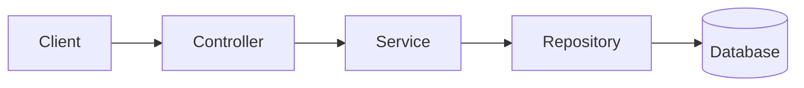

# Task Manager (Spring Boot)

    

**English** | [Português](README_BR.md)

A RESTful API for task management built with Java and Spring Boot. This project is a translation of an earlier [FastAPI version](https://github.com/ruanmarvila/gerenciador-tarefas), rebuilt to learn the Spring ecosystem: layered architecture organized by domain, JPA, Spring Security with JWT, database migrations, and automated tests.

---

# Contents

- [What I Learned](#what-i-learned)
- [Features](#features)
- [Technologies](#technologies)
- [Architecture](#architecture)
- [Design Decisions](#design-decisions)
- [Project Structure](#project-structure)
- [Installation](#installation)
- [API Documentation](#api-documentation)
- [Roadmap](#roadmap)
- [License](#license)

---

## What I Learned

- Build a layered architecture organized by domain (`auth/`, `users/`, `tasks/`);
- Apply the Controller, Service and Repository layers with Spring's dependency injection;
- Implement JWT authentication with Spring Security, and refresh token rotation with reuse detection and logout;
- Model relational data with JPA/Hibernate and version the schema with Flyway;
- Combine soft delete with database-level cascade, and keep tables from growing unbounded with scheduled cleanup jobs;
- Choose indexes by measuring with `EXPLAIN ANALYZE` instead of guessing;
- Write unit and integration tests with JUnit 5, Mockito and Testcontainers;
- Take the project beyond localhost: PostgreSQL, Docker, deploy and CI/CD.

---

## Features

**Base URL:**
```
http://localhost:8080
```

| Methods | Endpoints | Features |
| :------ | :-------- | :------- |
| POST | `/auth/register` | Create a user |
| POST | `/auth/login` | Authenticate and receive access and refresh tokens |
| POST | `/auth/refresh` | Exchange a refresh token for a new access token and a new refresh token (rotation) |
| POST | `/auth/restore` | Restore a disabled account (within the recovery window) |
| POST | `/auth/logout` | Revoke current refresh token (idempotent, no access token required) |
| GET | `/users/me` | Retrieve the user's information |
| PATCH | `/users/me` | Update the user's name and e-mail |
| PATCH | `/users/me/password` | Update the user's password and revoke all refresh tokens |
| DELETE | `/users/me` | Soft-delete the user account and revoke all refresh tokens |
| POST | `/tasks` | Create a task |
| GET | `/tasks` | List the user's tasks, paginated. Params: filters (see Swagger UI), `page`, `size` (max 50), `sort` (e.g. `sort=title,asc`) |
| GET | `/tasks/{id}` | Retrieve a user's task |
| PATCH | `/tasks/{id}` | Update a task's title, description and status |
| DELETE | `/tasks/{id}` | Soft-delete a task |
| GET | `/tasks/trash` | List deleted tasks, paginated (`page`, `size`, `sort`), without filters |
| POST | `/tasks/{id}/restore` | Restore a deleted task |
| DELETE | `/tasks/trash` | Permanently delete all tasks in the trash |

---

## Technologies

| Technology | Purpose |
| :--------- | :------ |
| Java 25 | Programming language |
| Spring Boot | Application framework |
| Spring Web | REST controllers |
| Spring Data JPA (Hibernate) | ORM and repositories |
| Spring Security | Authentication and authorization |
| jjwt | Access token generation and validation |
| Argon2 (Spring Security + Bouncy Castle) | Password hashing |
| Bean Validation | DTO validation |
| Flyway | Database migrations |
| H2 | In-memory database for service and controller tests |
| PostgreSQL | Database |
| Spring Boot Actuator | Health endpoint |
| springdoc-openapi | Swagger UI |
| JUnit 5 and Mockito | Unit testing |
| Testcontainers | Integration tests against a real PostgreSQL |
| Docker and Docker Compose | Containerization |
| GitHub Actions | CI |
| Maven | Build and dependency management |

---

## Architecture



Each domain owns its own Controller, Service, Repository, entities, DTOs and exceptions, instead of grouping classes by technical layer.

---
 
## Design Decisions
 
### Security
 
- **Opaque, hashed refresh tokens with rotation.** Refresh tokens are random 256-bit strings, stored only as SHA-256 hashes. Each `/auth/refresh` revokes the used token and issues a new one in the same family. A revoked token presented again revokes the whole family (possible theft). Cost: one database read per refresh, unlike a stateless JWT.
- **Single use enforced by the database.** Consuming a token is a conditional `UPDATE ... WHERE revoked_at IS NULL`, and the affected row count decides who won a concurrent request. Chosen over `@Version` because there is no think time between the read and the write.
- **No wrapping transaction in the refresh flow.** The family revocation must commit before the `401` is returned, otherwise the rollback would undo it.
- **Public logout.** `/auth/logout` authenticates by the refresh token itself, so it still works after the access token has expired. It never reveals whether the token existed.
- **Sessions revoked on password change and account deletion.**
- **Refresh token in the response body.** The API has no browser client. For a web front end, an `HttpOnly`, `SameSite=Strict` cookie scoped to `/auth` is recommended, keeping the access token only in memory.

### Data
 
- **Soft delete with native queries.** `@SQLRestriction` hides deleted rows from JPQL, so queries that must see them are native.
- **Database-level `ON DELETE CASCADE`, no JPA cascade.** Soft-deleting an account is an `UPDATE`, so tasks stay untouched and restoring is trivial. Only the final purge, a real `DELETE`, cascades to tasks and refresh tokens.
- **Scheduled cleanup per table.** Accounts (30-day recovery window), expired refresh tokens and trashed tasks each have a job, so nothing grows unbounded.
- **Indexes chosen by measurement.** On 100k tasks (200 users, 500 tasks each), `idx_tasks_user_id` cut the task listing from 43 ms to 0.3 ms and the cascade of an account purge from about 124 ms to about 7 ms. A composite index `(user_id, created_at DESC)` and a partial index on `deleted_at` were measured and rejected: no meaningful gain at this scale for the former, and a once-a-day job for the latter.
- **`LocalDateTime` everywhere.**, with an injected `Clock` so time-dependent logic is testable. Trade-off: no time zone information, acceptable for a single-region deployment.
- **References by id.** `RefreshToken` stores `userId` instead of a `@ManyToOne`, since it is never navigated to `User`.

### API
 
- **Pagination.** with `Pageable` and `PagedModel` (stable JSON contract) on both task listings. Filters go through JPA `Specification` and exist only on `GET /tasks`. The page size is capped by `spring.data.web.pageable.max-page-size`, so a client cannot request an arbitrarily large page. Ownership is enforced in every query.

---

## Project Structure

```
.
├── src/
│   ├── main/
│   │   ├── java/dev/ruancmm/gerenciador_tarefas/
│   │   │   ├── auth/           # Authentication
│   │   │   │   ├── AuthController.java
│   │   │   │   ├── AuthService.java
│   │   │   │   ├── CustomUserDetailsService.java
│   │   │   │   ├── JwtAuthFilter.java
│   │   │   │   ├── JwtUtil.java
│   │   │   │   ├── RefreshToken.java
│   │   │   │   ├── RefreshTokenService.java
│   │   │   │   ├── RefreshTokenRepository.java
│   │   │   │   ├── RefreshTokenCleanupJob.java
│   │   │   │   ├── RotationResult.java
│   │   │   │   ├── TokenHasher.java
│   │   │   │   ├── exception/
│   │   │   │   └── dto/
│   │   │   │
│   │   │   ├── users/          # User domain
│   │   │   │   ├── User.java
│   │   │   │   ├── UserController.java
│   │   │   │   ├── UserService.java
│   │   │   │   ├── UserRepository.java
│   │   │   │   ├── AccountCleanupJob.java
│   │   │   │   ├── exception/
│   │   │   │   └── dto/
│   │   │   │
│   │   │   ├── tasks/          # Task domain
│   │   │   │   ├── Task.java
│   │   │   │   ├── TaskStatus.java
│   │   │   │   ├── TaskController.java
│   │   │   │   ├── TaskService.java
│   │   │   │   ├── TaskRepository.java
│   │   │   │   ├── TaskSpecification.java
│   │   │   │   ├── exception/
│   │   │   │   └── dto/
│   │   │   │
│   │   │   ├── core/           # Global configurations
│   │   │   │   ├── audit/
│   │   │   │   ├── config/
│   │   │   │   ├── entity/
│   │   │   │   ├── exception/
│   │   │   │   └── validation/
│   │   │   │
│   │   │   └── GerenciadorTarefasApplication.java
│   │   │
│   │   └── resources/
│   │       ├── db/migration/   # Flyway migrations
│   │       ├── application-security.properties
│   │       └── application.properties
│   │
│   └── test/
│       ├── java/dev/ruancmm/gerenciador_tarefas/
│       │   ├── auth/
│       │   │   ├── AuthControllerTest.java
│       │   │   ├── AuthServiceTest.java
│       │   │   ├── RefreshTokenIntegrationTest.java
│       │   │   ├── RefreshTokenServiceTest.java
│       │   │   └── RefreshTokenRepositoryTest.java
│       │   │
│       │   ├── users/
│       │   │   ├── UserControllerTest.java
│       │   │   ├── UserIntegrationTest.java
│       │   │   ├── UserRepositoryTest.java
│       │   │   └── UserServiceTest.java
│       │   │
│       │   ├── tasks/
│       │   │   ├── TaskAuditingTest.java
│       │   │   ├── TaskControllerTest.java
│       │   │   ├── TaskEntityTest.java
│       │   │   ├── TaskIntegrationTest.java
│       │   │   ├── TaskRepositoryTest.java
│       │   │   └── TaskServiceTest.java
│       │   │
│       │   ├── core/
│       │   │   ├── SecurityIntegrationTest.java
│       │   │   └── audit/
│       │   │       ├── AuditAspectIntegrationTest.java
│       │   │       └── AuditAspectTest.java
│       │   │
│       │   ├── config/
│       │   │   ├── FixedTimeConfig.java
│       │   │   └── PostgresContainerConfig.java
│       │   │
│       │   ├── support/
│       │   │   ├── AuthTestHelper.java
│       │   │   └── MutableClock.java
│       │   │
│       │   └── GerenciadorTarefasApplicationTests.java
│       │
│       └── resources/
│           └── application.properties
│
├── pom.xml
├── README_BR.md
└── README.md
```

---

## Installation

### Prerequisites

- [Git](https://git-scm.com/)
- [Docker Engine](https://docs.docker.com/engine/) 

### Step 1: Clone the repository

```bash
    git clone https://github.com/ruanmarvila/gerenciador-tarefas-spring.git
```

### Step 2: Configure environment variables

Create a `.env` file in the project root, using `.env.example` as a reference.

Configure the required variables, including:

- `DB_NAME`
- `DB_USERNAME`
- `DB_PASSWORD`
- `JWT_SECRET`
- Token expiration settings

### Step 3: Start the application

```bash
docker compose up -d --build
```

Docker Compose builds the application image, starts PostgreSQL, and starts the Spring Boot application after the database becomes healthy.

### Useful commands

View application logs:

```bash
docker compose logs -f app
```

Stop the services:

```bash
docker compose down
```

Flyway automatically applies database migrations when the application starts.

### Running the tests
 
```bash
./mvnw test
```
 
The integration tests use Testcontainers, so Docker must be running. They start a throwaway PostgreSQL container and apply the Flyway migrations to it.

---

## API Documentation

Once the server is running, the interactive documentation (springdoc-openapi) is available at:
- Swagger UI: http://localhost:8080/swagger-ui.html
- OpenAPI JSON: http://localhost:8080/v3/api-docs

Protected endpoints require a token. Use `/auth/login` to obtain one, then click **Authorize** in Swagger UI and paste the access token.

---

### Examples of Request and Response

```http
POST /auth/register
```

1. **Request:**
```json
{
    "name": "Ana",
    "email": "ana@gmail.com",
    "password": "12345678"
}
```

2. **Response (`201 CREATED`):**
```json
{
    "id": 1,
    "name": "Ana",
    "email": "ana@gmail.com"
}
```

---
 
```http
POST /auth/refresh
```
 
1. **Request:**
```json
{
    "refreshToken": "<current refresh token>"
}
```
 
2. **Response (`200 OK`):**
```json
{
    "accessToken": "<new access token>",
    "refreshToken": "<new refresh token>"
}
```
 
The refresh token sent in the request is revoked. Sending it again returns `401` and revokes every token issued from the same login.
 
---
 
```http
POST /auth/logout
```
 
1. **Request:**
```json
{
    "refreshToken": "<refresh token>"
}
```
 
2. **Response:** `204 No Content`, even if the token does not exist.

---

## Roadmap

### 1. Core
- [x] Project setup (Spring Initializr, Flyway, H2)
- [x] `users/`: entity, migration, repository, service
- [x] `auth/`: register, login, refresh token
- [x] `auth/`: account restore within the recovery window
- [x] `tasks/`: entity, migration, repository, service, controller
- [x] `tasks/`: trash (soft delete, restore, permanent delete)
- [x] `tasks/`: pagination, filters and sorting
- [x] Authorization by ownership (users only access their own tasks)

### 2. Quality
- [x] Validation with Bean Validation (DTOs)
- [x] Global exception handling (`BusinessException` hierarchy)
- [x] Swagger UI with the Bearer token scheme
- [x] Unit tests (services) with JUnit 5 and Mockito
- [x] Repository tests (`@DataJpaTest`) and controller tests (`MockMvc`)
- [x] Move the JWT secret to configuration, so tokens survive restarts

### 3. Production readiness
- [x] Switch H2 to PostgreSQL
- [x] Containerize the application and database with Docker
- [x] CI/CD pipeline (build and test on every push)
- [x] Deploy (short-lived, to get the experience of leaving localhost)

### 4. Next steps
- [x] Scheduled cleanup of accounts past the recovery window (`@Scheduled`)
- [x] Integration tests against PostgreSQL with Testcontainers (native queries and Flyway migrations)
- [x] Refresh token rotation with reuse detection and logout
- [x] Scheduled cleanup of expired refresh tokens and trashed tasks
- [x] Database-level cascade and indexes chosen with `EXPLAIN ANALYZE`
- [x] JPA auditing (`created_at` and `updated_at`)
- [x] Audit log of sensitive actions (AOP)

---

## License

This project is licensed under the [MIT License](LICENSE).