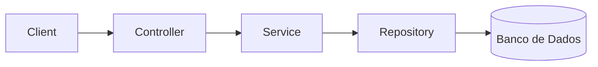

# Gerenciador de Tarefas (Spring Boot)

    

[English](README.md) | **Português**

Uma API RESTful para gerenciamento de tarefas desenvolvida em Java com Spring Boot. Esse projeto é uma tradução de um projeto anterior [versão FastAPI](https://github.com/ruanmarvila/gerenciador-tarefas), redesenvolvido para aprender o ecossistema Spring: arquitetura em camadas organizada por domínio, JPA, Spring Security com JWT, migrações de banco, e testes automatizados.

---

# Índice

- [O que Aprendi](#o-que-aprendi)
- [Funcionalidades](#funcionalidades)
- [Tecnologias](#tecnologias)
- [Arquitetura](#arquitetura)
- [Decisões de Projeto](#decisões-de-projeto)
- [Estrutura do Projeto](#estrutura-do-projeto)
- [Como Executar](#como-executar)
- [Documentação da API](#documentação-da-api)
- [Roteiro](#roteiro)
- [Licença](#licença)

---

## O que Aprendi

- Estruturar uma arquitetura em camadas organizada por domínios (`auth/`, `users/`, `tasks/`);
- Usar as camadas de Controller, Service e Repository com a injeção de dependência do Spring;
- Implementar autenticação JWT com *Spring Security*, e rotação de *refresh token* com detecção de reuso e *logout*;
- Modelar dados relacionais com JPA/Hibernate e versionar com Flyway;
- Combinar *soft delete* com *cascade* em nível de banco de dados, e manter controlado o crescimento das tabelas com trabalhos de limpeza agendados;
- Escolher índices a partir de mensurações com *`EXPLAIN ANALYZE`* em vez de adivinhar;
- Escrever testes unitários e de integração com JUnit 5, Mockito e Testcontainers;
- Levar o projeto além do localhost: PostgreSQL, Docker, deploy e CI/CD.

---

## Funcionalidades

**URL BASE:**
```
http://localhost:8080
```

| Método | Endpoints | Funcionalidade |
| :----- | :------- | :----------- |
| POST | `/auth/register` | Cria um usuário |
| POST | `/auth/login` | Autentica e retorna tokens de acesso e renovação|
| POST | `/auth/refresh` | Troca um *refresh token* por um novo *access token* e um novo *refresh token* (rotação) |
| POST | `/auth/restore`| Restaura uma conta desativada (dentro da janela de recuperação) |
| POST | `/auth/logout`| Revoga o *refresh token* atual (idempotente, não necessita do *access token*) |
| GET | `/users/me` | Retorna os dados do usuário |
| PATCH | `/users/me`| Atualiza nome e e-mail do usuário |
| PATCH | `/users/me/password`| Atualiza a senha do usuário e revoga todos os *refresh tokens* |
| DELETE  | `/users/me`| *Soft delete* da conta e revoga todos os *refresh tokens* |
| POST | `/tasks` | Cria uma tarefa |
| GET | `/tasks` | Lista todas as tarefas do usuário. Parâmetros: filtros (veja o Swagger UI), `page`, `size` (máximo 50), `sort` (ex.: `sort=title,asc`) |
| GET | `/tasks/{id}` | Consulta uma tarefa do usuário |
| PATCH | `/tasks/{id}` | Atualiza título, descrição e status de uma tarefa |
| DELETE  | `/tasks/{id}` | *Soft delete* de uma tarefa |
| GET | `/tasks/trash` | Lista todas as tarefas na lixeira, paginação (`page`, `size`, `sort`), sem filtros |
| POST | `/tasks/{id}/restore`| Restaura uma tarefa da lixeira |
| DELETE | `/tasks/trash` | Deleta permanentemente todas as tarefas na lixeira |

---

## Tecnologias

| Tecnologias | Finalidade |
| :---------- | :--------- |
| Java 25 | Linguagem de programação |
| Spring Boot | Framework |
| Spring Web | Controllers REST |
| Spring Data JPA (Hibernate) | ORM e repositórios |
| Spring Security | Autenticação e autorização |
| jjwt | Geração e validação de *access tokens* |
| Argon2 (Spring Security + Bouncy Castle) | Hash de senhas |
| Bean Validation | Validação de DTO |
| Flyway | Migração de banco |
| H2 | Banco de dados em memória para testes de services e controllers |
| PostgreSQL | Banco de dados |
| Spring Boot Actuator | endpoint de verificação de integridade |
| springdoc-openapi | Swagger UI |
| JUnit 5 e Mockito | Testes unitários |
| Testcontainers | Testes de integração contra um banco PostgreSQL real |
| Docker e Docker Compose | Conteinerização |
| GitHub Actions | CI |
| Maven | Construtor e gerenciador de dependências |

---

## Arquitetura



Cada domínio possui seu próprio Controller, Service, Repository, entidades, DTOs e exceções, em vez de agrupar classes por camada técnica.

---

## Decisões de Projeto

### Segurança

- **Refresh tokens opacos, com hash e rotação.** Os refresh tokens são strings aleatórias de 256 bits, armazenadas apenas como hashes SHA-256. Cada `/auth/refresh` revoga o token usado e emite um novo na mesma família. Um token revogado apresentado novamente revoga a família inteira (possível roubo). Custo: uma leitura no banco a cada refresh, ao contrário de um JWT stateless.
- **Uso único garantido pelo banco.** Consumir um token é um `UPDATE ... WHERE revoked_at IS NULL` condicional, e a quantidade de linhas afetadas decide quem venceu uma requisição concorrente. Escolhido no lugar do `@Version` porque não há tempo de reflexão entre a leitura e a escrita.
- **Sem transação envolvendo o fluxo de refresh.** A revogação da família precisa ser commitada antes de o `401` ser devolvido, caso contrário o rollback a desfaria.
- **Logout público.** O `/auth/logout` autentica pelo próprio refresh token, então continua funcionando depois que o access token expirou. Ele nunca revela se o token existia.
- **Sessões revogadas na troca de senha e na exclusão da conta.**
- **Refresh token no corpo da resposta.** A API não tem cliente de navegador. Para um front-end web, recomenda-se um cookie `HttpOnly` e `SameSite=Strict` restrito a `/auth`, mantendo o access token apenas em memória.

### Dados

- **Soft delete com queries nativas.** O `@SQLRestriction` esconde as linhas excluídas do JPQL, então as queries que precisam enxergá-las são nativas.
- **`ON DELETE CASCADE` no nível do banco, sem cascade do JPA.** O soft delete de uma conta é um `UPDATE`, então as tarefas ficam intocadas e restaurar é trivial. Só a purga final, um `DELETE` de verdade, propaga para as tarefas e para os refresh tokens.
- **Limpeza agendada por tabela.** Contas (prazo de recuperação de 30 dias), refresh tokens expirados e tarefas na lixeira têm um job cada, então nada cresce sem limite.
- **Índices escolhidos por medição.** Com 100 mil tarefas (200 usuários, 500 tarefas cada), o `idx_tasks_user_id` reduziu a listagem de tarefas de 43 ms para 0,3 ms e o cascade da purga de uma conta de cerca de 124 ms para cerca de 7 ms. Um índice composto `(user_id, created_at DESC)` e um índice parcial em `deleted_at` foram medidos e rejeitados: sem ganho relevante nessa escala no primeiro, e um job que roda uma vez por dia no segundo.
- **`LocalDateTime` em todo o projeto**, com um `Clock` injetado para que a lógica dependente de tempo seja testável. Trade-off: não há informação de fuso horário, aceitável para uma implantação em uma única região.
- **Referências por id.** O `RefreshToken` guarda o `userId` em vez de um `@ManyToOne`, já que nunca se navega dele até o `User`.

### API
 
- **Paginação** com `Pageable` e `PagedModel` (contrato JSON estável) nas duas listagens de tarefas. Os filtros usam `Specification` do JPA e existem apenas no `GET /tasks`. O tamanho da página é limitado por `spring.data.web.pageable.max-page-size`, então o cliente não consegue pedir uma página arbitrariamente grande. A posse dos dados é garantida em toda query.

---

## Estrutura do Projeto

```
.
├── src/
│   ├── main/
│   │   ├── java/dev/ruancmm/gerenciador_tarefas/
│   │   │   ├── auth/           # Autenticação
│   │   │   │   ├── AuthController.java
│   │   │   │   ├── AuthService.java
│   │   │   │   ├── CustomUserDetailsService.java
│   │   │   │   ├── JwtAuthFilter.java
│   │   │   │   ├── JwtUtil.java
│   │   │   │   ├── RefreshToken.java
│   │   │   │   ├── RefreshTokenService.java
│   │   │   │   ├── RefreshTokenRepository.java
│   │   │   │   ├── RefreshTokenCleanupJob.java
│   │   │   │   ├── RotationResult.java
│   │   │   │   ├── TokenHasher.java
│   │   │   │   ├── exception/
│   │   │   │   └── dto/
│   │   │   │
│   │   │   ├── users/          # Domínio de usuário
│   │   │   │   ├── User.java
│   │   │   │   ├── UserController.java
│   │   │   │   ├── UserService.java
│   │   │   │   ├── UserRepository.java
│   │   │   │   ├── AccountCleanupJob.java
│   │   │   │   ├── exception/
│   │   │   │   └── dto/
│   │   │   │
│   │   │   ├── tasks/          # Domínio de tarefas
│   │   │   │   ├── Task.java
│   │   │   │   ├── TaskStatus.java
│   │   │   │   ├── TaskController.java
│   │   │   │   ├── TaskService.java
│   │   │   │   ├── TaskRepository.java
│   │   │   │   ├── TaskSpecification.java
│   │   │   │   ├── exception/
│   │   │   │   └── dto/
│   │   │   │
│   │   │   ├── core/           # Configurações globais
│   │   │   │   ├── audit/
│   │   │   │   ├── config/
│   │   │   │   ├── entity/
│   │   │   │   ├── exception/
│   │   │   │   └── validation/
│   │   │   │
│   │   │   └── GerenciadorTarefasApplication.java
│   │   │
│   │   └── resources/
│   │       ├── db/migration/   # Migrações do flyway
│   │       ├── application-security.properties
│   │       └── application.properties
│   │
│   └── test/
│       ├── java/dev/ruancmm/gerenciador_tarefas/
│       │   ├── auth/
│       │   │   ├── AuthControllerTest.java
│       │   │   ├── AuthServiceTest.java
│       │   │   ├── RefreshTokenIntegrationTest.java
│       │   │   ├── RefreshTokenServiceTest.java
│       │   │   └── RefreshTokenRepositoryTest.java
│       │   │
│       │   ├── users/
│       │   │   ├── UserControllerTest.java
│       │   │   ├── UserIntegrationTest.java
│       │   │   ├── UserRepositoryTest.java
│       │   │   └── UserServiceTest.java
│       │   │
│       │   ├── tasks/
│       │   │   ├── TaskAuditingTest.java
│       │   │   ├── TaskControllerTest.java
│       │   │   ├── TaskEntityTest.java
│       │   │   ├── TaskIntegrationTest.java
│       │   │   ├── TaskRepositoryTest.java
│       │   │   └── TaskServiceTest.java
│       │   │
│       │   ├── core/
│       │   │   ├── SecurityIntegrationTest.java
│       │   │   └── audit/
│       │   │       ├── AuditAspectIntegrationTest.java
│       │   │       └── AuditAspectTest.java
│       │   │
│       │   ├── config/
│       │   │   ├── FixedTimeConfig.java
│       │   │   └── PostgresContainerConfig.java
│       │   │
│       │   ├── support/
│       │   │   ├── AuthTestHelper.java
│       │   │   └── MutableClock.java
│       │   │
│       │   └── GerenciadorTarefasApplicationTests.java
│       │
│       └── resources/
│           └── application.properties
│
├── pom.xml
├── README_BR.md
└── README.md
```

---

## Como Executar

### Pré-requisitos

- [Git](https://git-scm.com/)
- [Docker Engine](https://docs.docker.com/engine/) 

### Passo a Passo

1. **Clone o Repositório:**

```bash
    git clone https://github.com/ruanmarvila/gerenciador-tarefas-spring
```

2. **Configure as propriedades da aplicação:**

Crie um arquivo `.env` na raiz do projeto, use `.env.example` como referência.

Configure as variáveis necessárias, incluindo:

- `DB_NAME`
- `DB_USERNAME`
- `DB_PASSWORD`
- `JWT_SECRET`
- Token expiration

3. **Inicie o servidor:**

```bash
docker compose up -d --build
```

O Docker Compose constrói a imagem da aplicação, inicia o PostgreSQL e inicia a aplicação Spring Boot após o banco de dados estar em um estado saudável.

### Comandos úteis

Ver os *logs* da aplicação:

```bash
docker compose logs -f app
```

Parar os serviços:

```bash
docker compose down
```

Flyway roda as migrações automaticamente na inicialização.

### Rode os testes

```bash
./mvnw test
```

Os testes de integração usam o Testcontainers, então o Docker precisa estar rodando. Eles inicializam um contêiner PostgreSQL descartável e aplica as migrações do Flyway nele.

---

## Documentação da API

Com o servidor rodando, a documentação interativa (springdoc-openapi) estará disponível em:
- Swagger UI: http://localhost:8080/swagger-ui.html
- OpenAPI JSON: http://localhost:8080/v3/api-docs

Os *endpoints* protegidos pedem um token. Use `auth/login` para obtê-lo, então clique em **Authorize** no Swagger UI e cole o token de acesso (*access token*).

---

### Exemplos de Requisição e Resposta

```http
POST /auth/register
```

1. **Requisição:**
```json
{
    "name": "Ana",
    "email": "ana@gmail.com",
    "password": "12345678"
}
```

2. **Resposta Esperada (`201 CREATED`):**
```json
{
    "id": 1,
    "name": "Ana",
    "email": "ana@gmail.com"
}
```

---

```http
POST /auth/refresh
```
 
1. **Requisição:**
```json
{
    "refreshToken": "<refresh token atual>"
}
```
 
2. **Resposta (`200 OK`):**
```json
{
    "accessToken": "<novo access token>",
    "refreshToken": "<novo refresh token>"
}
```
 
O *refresh token* enviado na requisição é revogado. Enviá-lo novamente retorna `401` e revoga todos os tokens emitidos a partir do mesmo login. 
 
---
 
```http
POST /auth/logout
```
 
1. **Requisição:**
```json
{
    "refreshToken": "<refresh token>"
}
```
 
2. **Resposta:** `204 No Content`, mesmo que o token não exista.

---

## Roteiro

### 1. Core
- [x] Configuração do Projeto (Spring Initializr, Flyway, H2)
- [x] `users/`: entidade, migração, repository, service
- [x] `auth/`: register, login, refresh token
- [x] `auth/`: recuperação de conta com janela de arrependimento
- [x] `tasks/`: entidade, migração, repository, service, controller
- [x] `tasks/`: lixeira (*soft delete*, recuperação, exclusão permanente)
- [x] `tasks/`: paginação, filtro e ordenação.
- [x] Autorização (usuários só acessam suas próprias tarefas)

### 2. Qualidade
- [x] Validação com Bean Validation (DTOs)
- [x] Tratamento global de exceções (`BusinessException`)
- [x] Swagger UI com o Bearer token
- [x] Testes unitários (services) com JUnit 5 e Mockito
- [x] Testes de Repository (`@DataJpaTest`) e de Controllers (`@MockMvc`)
- [x] Mover as configurações de JWT, para os tokens sobreviverem à reinicialização

### 3. Produção
- [x] Trocar H2 para PostgreSQL
- [x] Containerizar a aplicação e o banco com Docker
- [x] CI/CD pipeline
- [x] Deploy (vida curta, para obter experiência e sair do localhost)

### 4. Próximos passos
- [x] Limpeza agendada de contas que ultrapassaram a janela de recuperação (`@Scheduled`)
- [x] Testes de integração com PostgreSQL via Testcontainers (queries nativas e migrations do Flyway)
- [x] Rotação de *refresh token* com detecção de reuso e logout
- [x] Limpeza agendada para *refresh token* expirados e tarefas na lixeira.
- [x] *Cascade* em nível do banco de dados e índices escolhidos com `EXPLAIN ANALYZE`
- [x] Auditoria do JPA (`created_at` e `updated_at`)
- [x] *Logs* de auditoria sobre ações sensíveis

---

## Licença

Este projeto está sob a [licença MIT](LICENSE).